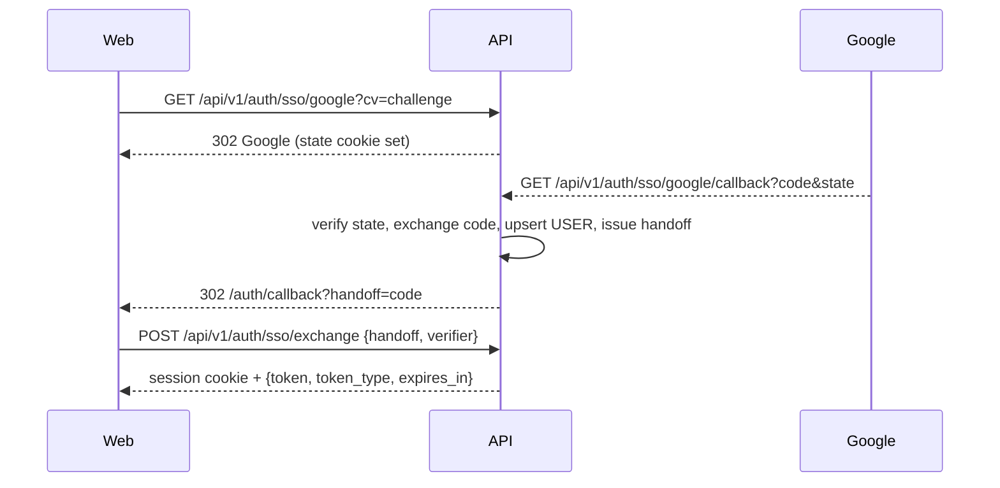
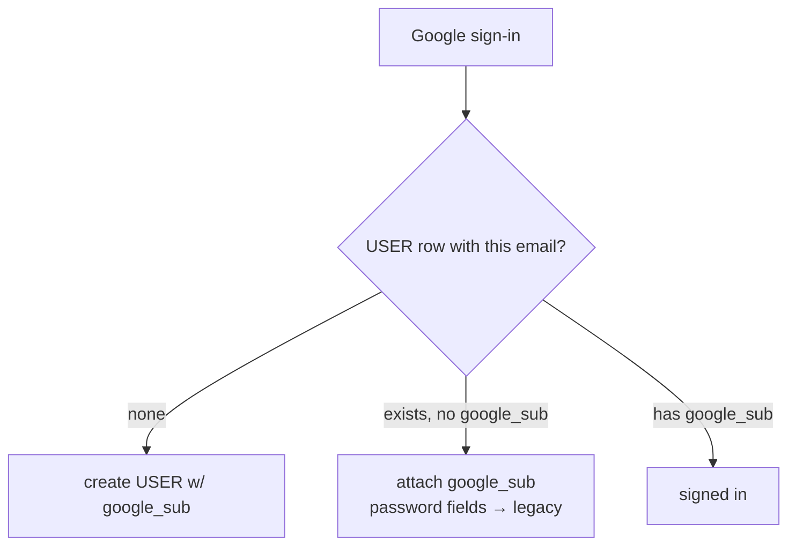

# Flow: Authentication (Google-only, API-issued session)

> Implements decision X-1 as hardened 2026-07-16: **Google sign-in only**,
> no username/password, product-wide. The API runs the Google OAuth flow and
> issues its own session JWT. Will retire the entire local credential system
> (signup/signin/forgot/reset/change-password in `user_controller.go` + their
> rate limiters and email templates) at the migration window; the Go password
> system still ships today.

## 1. Hard rule & enforcement

Google is the only identity provider: the API exposes no other sign-in route,
and the web shows a single "Continue with Google" CTA. `/signup`,
`/forgot-password` routes retire; `/signin` remains as the one auth screen.

## 2. Session model

- The web keeps a PKCE verifier in session storage and sends only its
  challenge (`cv`) at the start; the exchange proves possession of the
  verifier. A handoff code is one-time and lives 5 minutes.
- The API signs an HS256 JWT with `JWT_SECRET` (lifetime `JWT_ACCESS_TTL`,
  or `JWT_EXPIRY_HOURS` when unset) and sets it as the HttpOnly session
  cookie (`SESSION_COOKIE_NAME`). Every `/api/v1` call authenticates by that
  cookie or by `Authorization: Bearer <jwt>`; cookie requests also pass an
  origin check (`403 csrf_rejected`). `401 unauthenticated` covers a missing,
  invalid or expired token (cataloged in engineering.md §1).
- `POST /api/v1/auth/logout` clears the cookies (`204`).
- Upsert `USER` by `google_sub`. Error envelope (ecosystem standard,
  verbatim): `{"error": {"code": "snake_case", "message": "human copy",
  "details": {}}}`. The sign-in start and exchange routes carry their own
  per-source and global rate limits (Redis when configured, in-memory
  otherwise); Redis limits remain for non-auth routes.
- Failures redirect to `/auth/callback?error=...&error_description=...`, which
  offers a retry or a return to `/signin`.

**Session restore [Decided 2026-07-22, platform-neutral]**: restore
resolves **before either surface routes**: the web resolves the session
(`GET /api/v1/me` with the cookie) before dashboard routes render (the
`DashboardShell` gate), and the mobile app, when its phase opens, runs
the same silent restore behind its boot gate. A failed restore reads as
**signed out** (never an error interstitial): providers resolve `null`
and never throw past the seam; a signed-in user never sees the auth
screen (`/signin` carries the reverse guard).

## 3. Migration of legacy password users

- Google-asserted emails are verified by definition → link-by-email is safe
  (no unverified-email branch needed).
- **Window**: legacy `/users/signin` works 60 days with a "switch to Google"
  banner; then `410 migrate_to_google`; password/reset/change-password
  endpoints + email templates deleted; password fields dropped (data-model §3).
- **The stranded-user edge**: a legacy account whose email has no Google
  account (corporate/non-Gmail without Google Workspace). Policy: they sign
  in with *any* Google account and request an email change via support
  (`clients.cuesoft.io`), which re-links history after identity check —
  documented in the migration banner. Expected to be rare; measured by
  `auth_migration_stranded` (support-ticket count).

## 4. Post-auth gates

Consent on first protected action: `tos`, `privacy`, **`ai_processing`**
(declining disables AI-dependent paths only — E-3). Org scoping per E-4
unchanged.

## 5. Instrumentation & acceptance

Events: `auth_signin_completed`, `auth_migration_completed`,
`consent_recorded{document}` (emitted by the consent endpoints, E1-5) —
counters only. `auth_migration_stranded` is **not an ingest event** — it is
a support-ticket tag counted operationally (registry annotation updated).

- [ ] Legacy user links on first Google sign-in; history intact
- [ ] Day-61: legacy endpoints 410; password columns dropped; templates gone
- [ ] Forged, expired and wrong-secret tokens rejected (crafted-token test)
- [ ] A handoff code redeems once, and only with its verifier
- [ ] `/signup` + `/forgot-password` routes removed; 404 on the branded page (no redirect stub, web-implementation.md §4)
- [ ] Rate-limiter middleware removed from auth routes only
